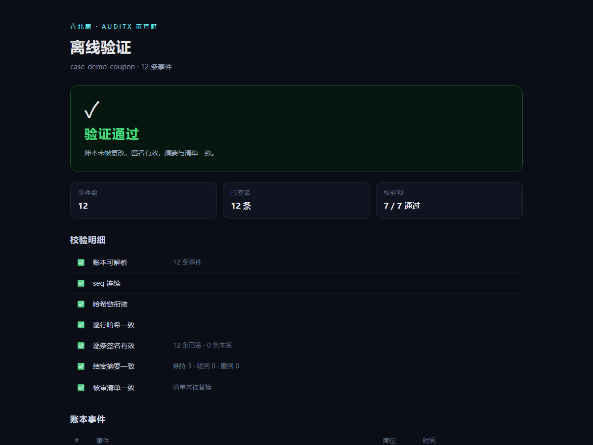
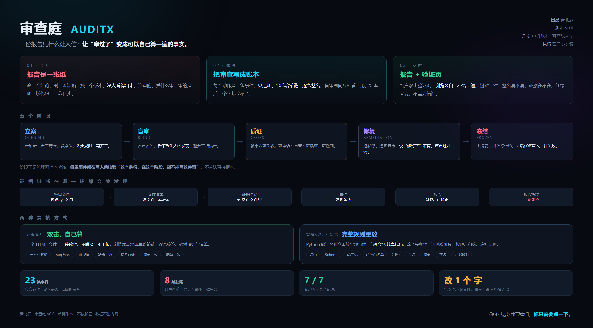

# AuditX Verifier


**Don't trust me. Recompute it yourself.**

An independent verifier for append-only review ledgers: hash chain + per-event
Ed25519 signatures + artifact manifest + evidence quote re-check.

It turns "this report is real" from a verbal promise into something anyone can
recompute on their own machine.

```
python verify_review_brain.py examples/case-demo
```

```
✅ V1-V9 all passed (structure / chain / phases / roles / leases / freeze / digest / projection)
   + V10 signatures / V11 evidence
```



---

## Architecture



---

## Why this exists

A software acceptance report is usually a Word file:

- change a conclusion, delete a finding — **nobody can tell**;
- who reviewed it, on what grounds, against which version of the code — all verbal;
- when things go wrong, each side produces its own "final version".

AuditX records the review as an **append-only event ledger**: every step is
signed, chained by hash, and pinned to the exact bytes of the reviewed artifact.
Anyone can verify it independently — including people who do not trust the
reviewer.

This repository is that verifier. It **imports none of the producer's code** and
recomputes every hash and every signature from scratch.

## Try it in 30 seconds

```bash
pip install jsonschema cryptography
python verify_review_brain.py examples/case-demo
```

Or open `examples/case-demo/verify.html` — **zero install, offline**, the same
checks re-run in your browser (pure JS, no third-party libraries).

## Live demo

**[comet815.github.io/auditx-verifier](https://comet815.github.io/auditx-verifier/)**

- original ledger → green "verified"
- tampered ledger (one word changed) → red "verification failed"

## What it checks

| ID | Check | Notes |
|---|---|---|
| V1 | Structure | 12-field envelope, ULID event ids |
| V2 | JSON Schema | per-event schema (`findings.schema.json`) |
| V3 | Chain | seq continuity, `prev_hash`, per-line hash recomputation |
| V4 | Phases | each event must appear in a legal phase |
| V5 | Roles | role allowlist: who may write which event |
| V6 | Leases | seat lease not expired |
| V7 | Frozen | no writes after freeze |
| V8 | Digest | final digest matches finding counts |
| V9 | Projection | `view.json` matches replayed state |
| V10 | Signatures | Ed25519 per-event verification |
| V11 | Evidence | artifact hashes, snapshot, quotes must really exist |

The browser build covers C1–C7 (chain, signatures, digest, manifest) — enough to
answer "was this report altered".

## Design principles

- **Zero shared logic** — the verifier never imports the producer. If the producer
  has a bug, the verifier catches it.
- **Plain text** — the ledger is JSONL: diffable, greppable, openable in Notepad.
- **Offline** — no network, no upload, no cloud.
- **Portable** — a case directory can be copied to another machine and still
  verify (the manifest stores relative paths).

## Boundaries (important)

- It verifies **the record was not altered**, not that the review was any good.
- A signature proves "these events were issued by the holder of this key", not
  that the issuer is honest.
- **The public key is where trust starts.** Obtain its fingerprint through a
  channel you already trust (contract annex, published page), not from the
  `pubkey.pem` that ships with the case.
- The ledger prevents *post-hoc edits*, not *fabrication at the start*. That is
  what blind review, cross-examination and sampling are for.

## Repository layout

```
verify_review_brain.py     CLI verifier (V1-V11)
findings.schema.json       event JSON Schema
verifier/
  verifier_core.js         browser kernel (SHA-256 / SHA-512 / Ed25519, hand-written)
  shell.html               page template
  test_verifier.js         16 checks, incl. 5 tamper cases
examples/case-demo/        second example: a script that passes gates but should not ship
examples/case-handoff/     first example: clean review, 12 signed events
docs/                      screenshots
.github/workflows/ci.yml   runs Python + Node on every push
```

## Tests

```bash
python verify_review_brain.py examples/case-demo   # V1-V11
node verifier/test_verifier.js                     # 16 kernel checks
```

## Related

The producer (review engine) is not open source — this repo only verifies, on
purpose. Sister project [Hummingbird](https://github.com/Comet815/hummingbird)
is a separate production pipeline, unrelated to this repo.

## License

MIT © 2026 Qingbeilu

---

[中文](README.md) · **English**
