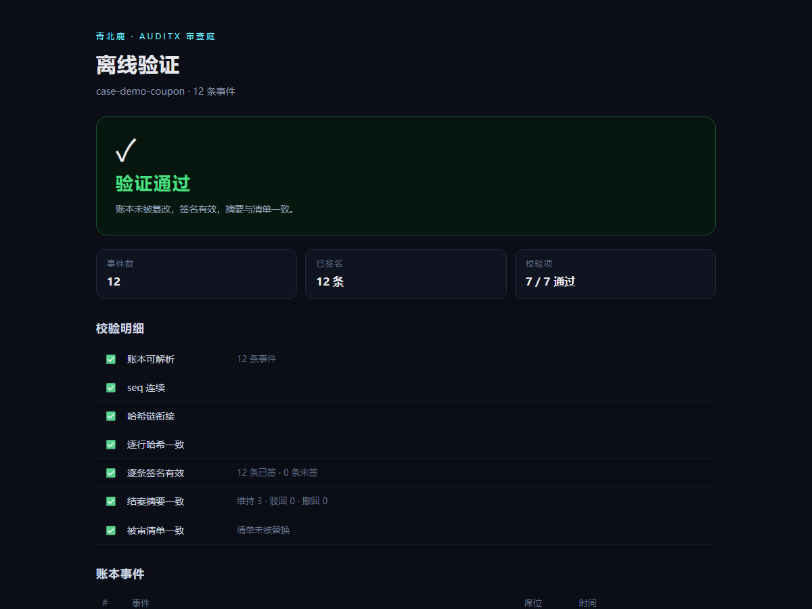
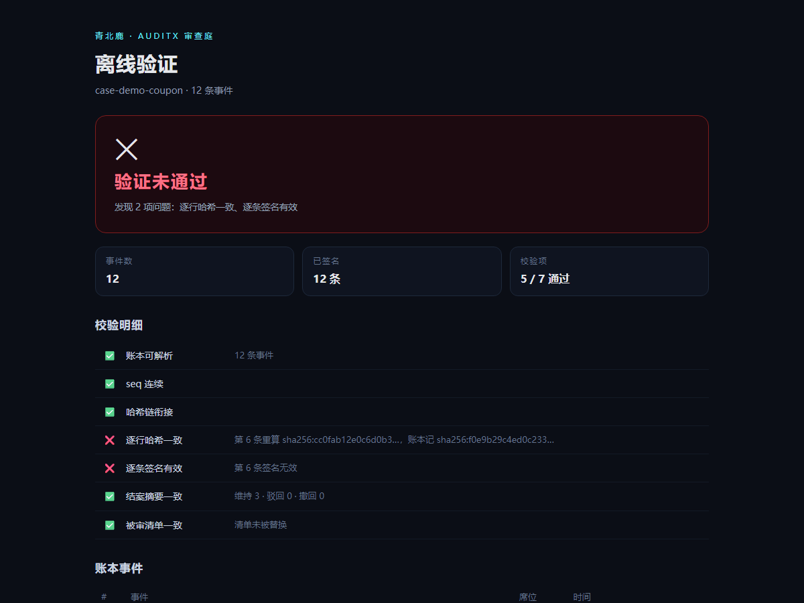

# AuditX Verifier

> **别信我，自己算。**

审查账本的**独立复核器**：哈希链 + 逐条 Ed25519 签名 + 被审文件清单 + 证据原文核对。

把"这份报告是真的"从一句口头保证，变成一个任何人都能在自己机器上重算一遍的结果。

```
python verify_review_brain.py examples/case-demo
```

```
✅ V1-V9 全部通过（结构 / 链 / 阶段 / 权限 / 租约 / 冻结 / 摘要 / 投影）＋V10 签名 / V11 证据核对
```



---

## 为什么需要它

现在的软件验收报告是一份 Word：

- 改一个结论、删一条缺陷，**没人看得出来**；
- 谁审的、凭什么审、审的是哪一版代码，全靠口头；
- 出了事，双方各拿一份"最终版"。

AuditX 的做法是把审查过程写成**只追加的事件账本**：每一步都签名、串成哈希链、钉住被审文件的指纹。
这份账本可以被任何人独立复核——包括不信任审查方的人。

本仓库就是那个"复核方"：它**不 import 生成端的任何代码**，从零重算每一条哈希和每一个签名。

## 三十秒跑一遍

```bash
pip install jsonschema cryptography
python verify_review_brain.py examples/case-demo
```

想看图？双击 `examples/case-demo/verify.html`——**零安装、不联网**，浏览器里把同样的检查再做一遍（纯 JS 实现，无第三方库）。

## 试试篡改

1. 双击 `examples/case-demo/verify.html`，看到绿色「验证通过」。
2. 用记事本打开同目录的 `findings.jsonl`，把任意一个词改掉，保存。
3. 回到浏览器刷新。

它会立刻变红，并指出第几条、哈希重算结果、签名无效。



命令行同样：

```
❌ V3 第 6 条事件 hash 与重算不一致
❌ V10 第 6 条事件签名无效
```

## 校验什么

| 编号 | 检查 | 说明 |
|---|---|---|
| V1 | 结构 | 12 字段信封、ULID 事件 ID、必需字段 |
| V2 | Schema | 事件级 JSON Schema（`findings.schema.json`） |
| V3 | 链 | seq 连续、`prev_hash` 衔接、逐行 hash 重算 |
| V4 | 阶段 | 每条事件必须出现在合法阶段 |
| V5 | 权限 | 角色白名单：谁能写哪种事件 |
| V6 | 租约 | 席位租约未过期 |
| V7 | 冻结 | 冻结后任何写入都非法 |
| V8 | 摘要 | 结案摘要与缺陷计数一致 |
| V9 | 投影 | `view.json` 与账本重放结果一致 |
| V10 | 签名 | 每条事件 Ed25519 验签 |
| V11 | 证据 | 被审文件哈希、快照、证据原文必须真实存在 |

浏览器版覆盖其中 C1–C7（链、签名、摘要、清单），足够回答"这份报告有没有被动过"。

## 两个复核入口

| | 谁用 | 覆盖 |
|---|---|---|
| CLI（Python） | 机构、监管、法务 | V1–V11，含阶段/权限/租约 |
| `verify.html`（浏览器） | 客户 | C1–C7，零安装 |

两者独立实现，互相印证。

## 设计原则

- **零共享逻辑**：复核器不引用生成端代码，只按规范重放。生成端有 bug，复核器会当场发现。
- **纯文本**：账本是 JSONL，能 `diff`、能 `grep`、能用记事本打开。
- **离线**：不联网、不上传、不依赖云。
- **可搬移**：案件目录整体拷走（换机器、发给客户）仍然可复核，清单里记的是相对路径。

## 边界（重要）

- 它验证的是**记录有没有被改动**，不是"这次审查做得好不好"。
- 签名只证明"这串事件由持私钥的一方签发"，不证明签发者品德高尚。
- **公钥的分发是信任起点**：请通过合同附件、官网公告等独立渠道拿到公钥指纹，而不是只信压缩包里的 `pubkey.pem`。
- 账本只能防止**事后修改**，不能防止**一开始就编造**——那要靠盲审、交叉质证和抽样复算。

## 目录

```
verify_review_brain.py      CLI 复核器（零依赖，可选 jsonschema / cryptography）
findings.schema.json        事件 JSON Schema
verifier/
  verifier_core.js          浏览器复核内核（SHA-256 / SHA-512 / Ed25519 全手写）
  shell.html                页面模板
  test_verifier.js          内核测试（16 项，含 5 组破坏性用例）
examples/case-demo/
  findings.jsonl            示例账本（12 条事件，已签名）
  artifact.manifest.json    被审文件清单
  pubkey.pem                示例公钥
  verify.html               双击即验
  report.html               审查报告长什么样
  artifact/                 被审的示例代码（故意留了 3 个缺陷）
.github/workflows/ci.yml    每次提交跑 Python + Node 两套检查
```

## 测试

```bash
python verify_review_brain.py examples/case-demo   # V1–V11
node verifier/test_verifier.js                     # 内核 16 项
```

内核测试覆盖：SHA-256/SHA-512 已知向量、Ed25519 基点编码、示例案件全通过，
以及四类破坏（改事件、换公钥、换清单、删事件）必须被抓住。

## 相关

生成端（审查引擎）未开源——本仓库只做复核，故意不包含生成逻辑。
姊妹项目 [Hummingbird](https://github.com/Comet815/hummingbird) 是另一条生产流水线的方法说明，与本仓库无关。

## License

MIT © 2026 青北鹿

---

## English

**AuditX Verifier** — an independent verifier for append-only review ledgers.

Reviewers record every step of a code/document review as a signed event: hash-chained,
Ed25519-signed, pinned to the exact bytes of the reviewed artifact. Anyone can re-verify
the whole record offline, without trusting the reviewer and without importing any of the
producer's code.

```bash
pip install jsonschema cryptography
python verify_review_brain.py examples/case-demo   # V1–V11
node verifier/test_verifier.js                     # 16 checks, incl. tamper cases
```

Open `examples/case-demo/verify.html` for a zero-install, offline browser check
(pure JS: SHA-256, SHA-512 and Ed25519 implemented from scratch, no dependencies).

What it proves: the record was not altered after signing. What it does not prove:
that the review was any good. Trust still starts at the public key — obtain its
fingerprint through a channel you already trust.
